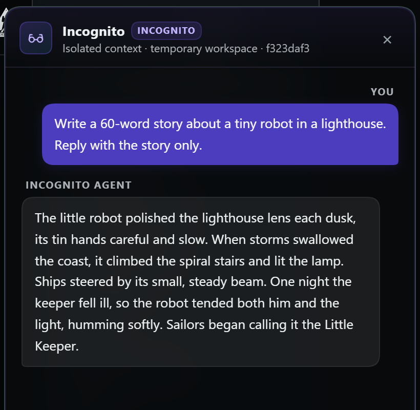
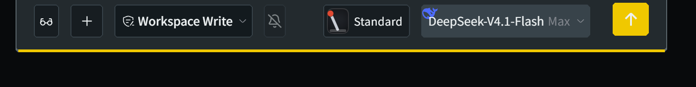
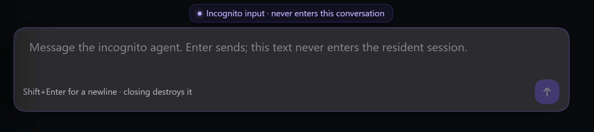
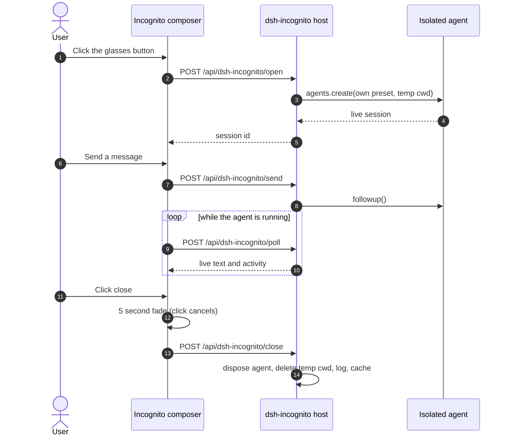

# dsh-incognito

Incognito sessions for **DeepSeek Harness**: one click opens an independent,
temporary agent in a floating window. It has its own context, its own working
directory, and its own toolset — and it is destroyed when the window closes.

Repository: <https://github.com/Raikouzen/dsh-incognito>



*An incognito agent answering in the floating window. The resident conversation
received no message, tool call, or transcript row.*

## Features

### One-click activation

- A glasses button sits beside the composer `+`.
- The floating window opens immediately and the composer switches to a
  dedicated incognito input bar.
- The window is draggable and is positioned in the left gutter so the full
  incognito input bar stays visible.

### Complete isolation

- Every session mounts a private `incognito` agent preset.
- No parent seed, no inherited transcript, no parent memory, and no inherited
  persona.
- The working directory is a dedicated temporary directory outside every
  registered DSH workspace.
- The session is created as `origin: "subagent"` without `parentSession`, so
  root-only memory hooks do not attach to it.

### Full toolset

| Area | Included tools |
| --- | --- |
| Shell | `pwsh` on Windows, `bash` elsewhere |
| Files | read, write, edit, glob, grep |
| Background work | jobs |
| Skills | filesystem skill catalog and `skill` |
| Goals | goal tool |
| Delegation | `subagent`, `subagent_fork`, subagent control |
| Orchestration | workflow and Ralph |
| Web | search and `web_fetch` |
| Session | todo, ask-user |

### Lifecycle

- Clicking close fades the window for **five seconds** before anything is
  deleted.
- Clicking anywhere inside the window during the fade cancels the close,
  restores full visibility, and leaves the session usable.
- After the fade, the agent is disposed and its session directory and
  temporary working directory are removed. Projection-cache and workspace
  references are guarded and cleaned as well.
- Page refresh and host restart sweep orphaned incognito directories.
- Readiness is fail-closed: if the projection cache cannot be guarded, the
  entry button refuses to open a session.

### Privacy

- The resident session never receives an incognito message, tool call, or
  transcript row. The browser talks to the plugin's own
  `/api/dsh-incognito/*` routes; the host creates the agent directly with
  `ctx.agents.create`.
- The temporary working directory is the session's sandbox boundary. Child
  agents created by the incognito agent use the same project directory, and
  their logs are deleted with it.
- DSH's projection cache is patched to skip incognito ids, so titles, token
  counts, and last-prompt checkpoints are not written.
- The plugin does not write its window state or drafts to `localStorage`,
  `sessionStorage`, or IndexedDB.
- A close, refresh, or restart leaves no incognito session directory, temporary
  working directory, projection-cache file, or workspace id behind.

## Screenshots

### Entry point



The glasses button sits beside the normal composer controls. Clicking it opens
the window and swaps in the incognito bar.

### Incognito input bar



While a session is open, the stock composer is replaced by this bar, so typed
text cannot fall through to the resident conversation.

## Install

The easiest path is the Web plugin manager: add
`https://github.com/Raikouzen/dsh-incognito`, select the `dsh-incognito`
bundle, and restart DSH.

From a shell:

```sh
dsh plugin --profile web add github:Raikouzen/dsh-incognito
```

Then select `dsh-incognito` as a profile bundle in the Web plugin manager and
restart DSH. The bundle patch declares both the host module and the `incognito`
agent preset.

From a local checkout:

```sh
dsh plugin --profile web add file:/absolute/path/to/dsh-incognito
```

For development:

```sh
cd ~/.dsh/profiles/web
pnpm add file:/absolute/path/to/dsh-incognito
```

Make sure `dsh-incognito` is present in `package.json`'s
`dsh.profile.bundles`, then restart DSH after changing host code.

## Usage

1. Click the glasses icon beside the composer `+`.
2. A floating incognito window opens and the input bar switches to the
   incognito bar.
3. Type a message and press Enter. `Shift+Enter` inserts a newline.
4. Close the window with `×`. The window fades for five seconds; click anywhere
   inside it before the fade ends to keep the session.
5. Once the fade completes, the agent and its local artifacts are removed.

## How it works



The host owns the only live registry of incognito sessions. The browser never
opens a normal DSH conversation for them, and the host never routes incognito
prompts through the resident agent.

## Requirements

- DeepSeek Harness `0.2.2-rc.1` (the version this plugin was developed and
  verified against).
- A Web profile with the standard projection-cache service. The plugin refuses
  to promise a zero-trace session if that service cannot be guarded.
- A default model configured in the profile (the agent window does not expose a
  model picker).

## Project layout

```text
cordis.patch.yml       preset + host bundle patch
lib/index.js           host: lifecycle, exact Fetch routes, cleanup
lib/client.js          client: entry button, shadow composer, floating window
lib/core.js            pure path/format/stream helpers
test/core.test.mjs     pure helper tests
docs/                  README screenshots
```

## Development

Run the pure helper tests directly:

```sh
node test/core.test.mjs
```

Host changes require a DSH restart. Client-only changes can be refreshed in the
browser while the profile is running.

## Limitations and non-goals

- The model provider still receives the conversation as a normal API request.
  Provider-side retention is outside this plugin's control.
- Aggregate token/cost meters may record usage; they do not receive the
  incognito transcript from this plugin, but they are not disabled.
- Approval prompts are pinned to `never` so tools do not hang behind a missing
  UI; tools that require interactive approval fail instead of blocking.
- Tools that attempt to write outside the session's temporary cwd are subject
  to DSH's normal sandbox policy.
- Force-quitting DSH or losing the host process relies on the next boot sweep
  to remove residual directories.

## License

MIT. See [LICENSE](LICENSE).
